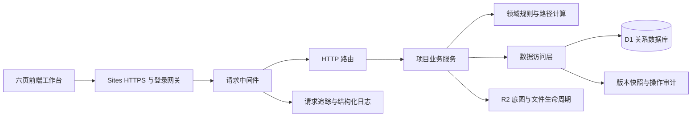
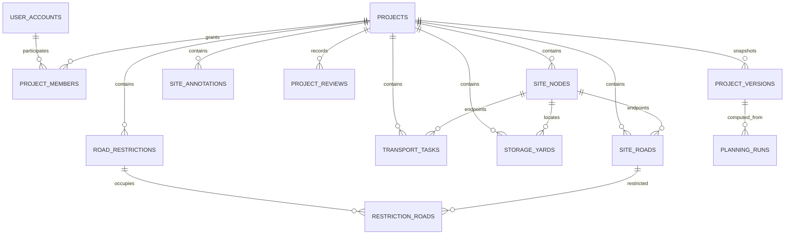
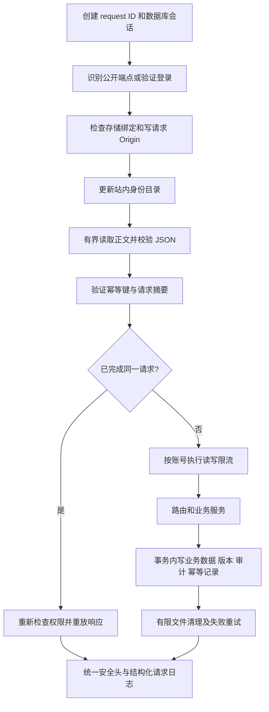
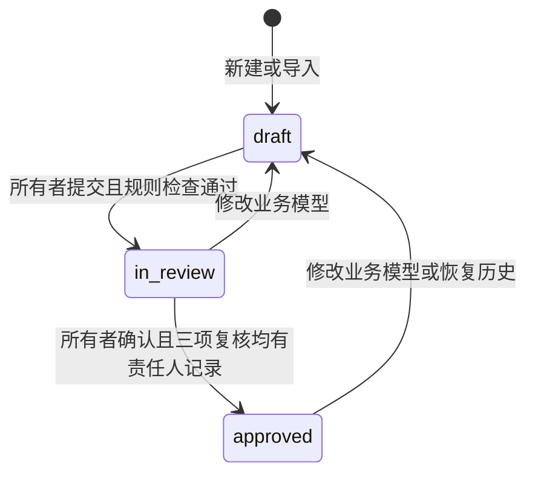

# 建材智途 AI 后端架构与数据库设计

本文对应 4.0 版实现，说明后端职责、数据库结构、请求中间件和一致性策略。3.0 版已有 API、D1 与 R2，但业务数据主要保存在项目 JSON 中；4.0 将场地、任务及调度等实体拆入业务表，增加服务端计算、成员角色、复核流程和可恢复历史。

## 系统结构

| 层 | 实现 | 责任 |
| --- | --- | --- |
| 网关 | Sites 平台 | HTTPS、正式登录、请求身份注入 |
| 请求中间件 | `lib/http/middleware.mjs` | 身份检查、来源检查、正文限制、幂等、限流、错误、安全响应头、请求日志 |
| HTTP 路由 | `lib/http/router.mjs` | 匹配资源和方法，调用业务服务，兼容原 `/api/projects` 接口 |
| 业务服务 | `lib/services/projects.mjs` | 项目和实体 CRUD、成员权限、复核状态、计算记录、历史恢复 |
| 领域规则 | `lib/domain/project.mjs`、`lib/engine.mjs` | 字段及引用校验、道路筛选、路径与工时计算、点位比较、调度冲突 |
| 数据访问 | `lib/repositories/projects.mjs` | 参数化查询、关系化读写、版本检查、事务批次和旧数据展开 |
| 文件服务 | `lib/services/assets.mjs` | 图片摘要、对象存储、历史引用保留、延迟清理和失败重试 |
| 浏览器适配 | `public/platform/cloud.js` | 调用业务 API、离线草稿、版本冲突处理和跨设备读取 |
| 业务界面 | `public/platform/backend.js` | 方案校验记录、提交与确认、历史恢复、成员管理 |

登录继续使用托管平台身份。本应用不增加另一套密码库，也不把邮箱当作权限主键；稳定的站内用户 ID 才是账号和成员关联依据。

## 数据库关系

数据库现在有 18 张表，包括原有两张表。数据库定义在 `db/schema.ts`，精确 DDL、约束和索引见 `drizzle/0000_ordinary_red_hulk.sql` 与新增的 `drizzle/0001_fixed_jasper_sitwell.sql`。

`audit_events` 与 `asset_gc` 不设级联删除的项目外键：永久删除项目后，仍需保留删除审计，并清理失去引用的对象文件。`projects.owner_id` 沿用旧字段，通过服务权限检查关联稳定用户 ID，避免为了加外键重建已有项目表。

| 表 | 主键及主要字段 | 用途及约束 |
| --- | --- | --- |
| `user_accounts` | `id`；`email`、`display_name`、`created_at`、`last_seen_at` | 站内登录身份目录；邮箱索引用于所有者添加已注册成员，权限仍按 ID 判断 |
| `projects` | `id`；`owner_id`、名称、阶段、场地尺寸、来源、需求面积、模型修订号、版本号、流程状态、归档时间 | 项目聚合根；`normalized_version` 标记关系数据版本，`mutation_token` 保护事务内后续语句 |
| `project_members` | `(project_id,user_id)`；`role` | 成员角色限定 `editor`、`viewer`；所有者由 `projects.owner_id` 确定，每项目最多 20 位协作成员 |
| `site_nodes` | `(project_id,node_id)`；名称、`x`、`y` | 坐标非负，领域层另检查场地边界 |
| `site_roads` | `(project_id,road_id)`；两端节点、长度、净宽、封闭标志 | 两端使用同项目复合外键；长度和净宽大于零，不允许同起终点 |
| `transport_tasks` | `(project_id,task_id)`；物料、起终点、车次、净宽、速度、装卸、设备成本、基线、时窗、设备 | 车次与通行参数为正；起终点使用复合外键；按项目、设备、开始时间建立索引 |
| `storage_yards` | `(project_id,yard_id)`；名称、节点、面积、调整投入、占地确认 | 节点使用复合外键；面积与投入非负 |
| `road_restrictions` | `(project_id,restriction_id)`；名称、开始和结束时间 | 领域层检查同日有效时窗，结束晚于开始 |
| `restriction_roads` | `(project_id,restriction_id,road_id)` | 占道与道路多对多关系，分别外键关联时窗和道路 |
| `site_annotations` | `(project_id,annotation_id)`；文字、坐标 | 人工标注，不自动参与禁行判断 |
| `project_reviews` | `(project_id,kind)`；勾选、复核人 ID、复核时间 | 三种复核事项，kind 为 0–2；模型变更会清除勾选与责任记录 |
| `project_versions` | `(project_id,version)`；快照、底图对象键与摘要、操作、操作人、时间 | 不覆盖已有版本；恢复生成新草稿；保留最近 30 个数据版本 |
| `planning_runs` | `id`；项目、输入版本与摘要、任务、状态、结果、操作人、时间 | 复合外键绑定输入快照；旧输入版本的结果显示为过期 |
| `audit_events` | `id`；项目、操作人、动作、request ID、摘要、时间 | 和业务事务一起写入；不记录底图或完整请求正文 |
| `api_rate_limits` | `key`；窗口、计数 | 按用户和读写类别实行分布式固定窗口限流 |
| `api_idempotency` | `(owner_id,key)`；请求摘要、响应、状态、时间 | 同一逻辑写请求可重试；同键不同内容拒绝；过期记录按用户清理 |
| `asset_gc` | 对象键；项目、创建时间 | 可重试的文件清理队列，删除前检查当前项目和历史版本引用 |
| `write_limits` | `owner_id`；旧窗口、计数 | 保留 3.0 兼容表，新中间件使用 `api_rate_limits` |

### JSON 的保留范围

`projects.payload` 保留为兼容快照，便于旧备份导入与回退识别；它不再是已展开项目的道路、任务或堆场读取来源。业务读取由各关联表组合，再检查版本一致性。`project_versions.payload` 是不可变历史快照，`planning_runs.result` 是对应输入版本的计算输出，二者适合以 JSON 保存。

道路记录长度与地图坐标分别存储。路径计算以记录长度为准；地图上的建筑示意、图片和文字标注不自动构成道路约束。

## 权限设计

| 操作 | 所有者 | 编辑者 | 查看者 |
| --- | --- | --- | --- |
| 读取模型、计算历史、版本和审计 | 是 | 是 | 是 |
| 下载现有成果 | 是 | 是 | 是 |
| 编辑节点、道路、任务、堆场、时窗 | 是 | 是 | 否 |
| 生成并保存计算记录 | 是 | 是 | 否 |
| 恢复历史为新草稿 | 是 | 是 | 否 |
| 提交复核、确认方案 | 是 | 否 | 否 |
| 增删或更新成员 | 是 | 否 | 否 |
| 归档、恢复归档、永久删除 | 是 | 否 | 否 |

每个查询先验证项目归属或成员关系。知道 UUID 不足以获得访问权。不存在与无权访问的项目统一返回 404，已获只读权限的成员尝试写入时返回 403。撤销成员权限后，旧幂等响应也会重新检查访问资格。

## 中间件执行顺序

| 中间件 | 实际行为 |
| --- | --- |
| 请求追踪 | 每次请求生成 UUID，返回 `X-Request-Id`；错误正文也包含相同 ID |
| 身份认证 | 使用托管平台身份；仅会话、健康和 OpenAPI 的 GET 允许匿名 |
| 角色鉴权 | 业务层逐次检查所属项目的 owner/editor/viewer，写事务的 SQL 再检查权限 |
| 请求来源 | 写请求要求同源 `Origin`，拒绝跨站来源，不开放跨站写 CORS |
| 输入边界 | JSON 正文最大 4 MB，流式累积限制，读取超时 12 秒；空动作正文兼容实际 HTTP 空流 |
| 领域验证 | 节点范围、道路连通引用、净宽、车次、时窗、面积等由统一规则校验；实体 API 拒绝未知字段和 ID 修改 |
| 幂等 | 推荐每个逻辑写请求携带 UUID `Idempotency-Key`；摘要含方法、路径、版本和正文；响应与业务数据同批提交 |
| 并发控制 | 修改需 `If-Match: "版本"`；旧版本返回 409，不覆盖新内容 |
| 限流 | 每账号读请求每分钟 300 次，写请求每小时 240 次；429 带 `Retry-After` |
| 错误处理 | 统一 `error`、`code`、`requestId`，业务阻断可含 `details`；不向客户端输出堆栈或 SQL |
| 安全响应 | no-store、nosniff、Referrer-Policy、Permissions-Policy、API CSP |
| 审计 | 业务成功时在同一事务记录动作、责任人和版本；失败不伪造成功记录 |
| 完成钩子 | 有限清理失效底图和过期幂等键；临时文件存储故障保留重试队列 |

请求日志只记录方法、路径、状态、耗时和 request ID。正式平台的登录由网关负责，不能另外公开一个允许访客伪造身份头的 Worker 直连入口。

## 原子性与版本控制

D1 使用 `batch()` 将关联写入合成事务。第一条语句按旧版本和当前权限执行条件更新，同时生成新的不可预测 `mutation_token`。删除旧实体、插入新实体、快照、审计和幂等记录的后续语句全部要求这个 token 仍属于本次操作。

因此，版本比较失败时，后续语句也没有写入资格；不会出现“主表更新失败，但后续删除了别人任务”的问题。任何一条约束或数据库操作失败时，整批回滚。批量实体通过 `json_each` 绑定数组导入，避免把大量节点拆成数百个网络往返。

读取主记录后，会在关系数据读取批次中再次核对版本，避免混合两个不同版本的节点与元数据。请求内使用 D1 的 primary-first 会话，保持写后读取顺序。

底图先暂存到 R2，再提交数据库引用；数据库失败时删除本次暂存对象。已经被历史快照引用的文件继续保留。版本过期或永久删除时先进入清理队列，确认无当前或历史引用后再删除；临时失败可以在后续请求重试。

## 计算与方案流程

计算输入来自数据库内的节点、道路、任务和时窗，而非客户端提交的距离结果。输出记录包含输入版本、输入摘要、算法版本、路线、工时、点位成本、全部任务概况与调度问题。输入版本改变后，旧结果仍可阅读，但会标记过期。

确认流程是本系统内的项目确认，不代替工程现场审批。转角、地面承载、装卸条件和真实作业窗口仍由责任人员核实。系统没有连接图像识别或大模型接口，不把规则计算包装为外部 AI 服务。

## 迁移与部署

1. 保持已经应用的 `0000` SQL 与元数据不变。
2. 发布时由托管平台应用新增 `0001`，只创建表、约束、索引和带常量默认值的字段。
3. 旧项目仍保留 `payload`。首次读取时，以当前项目版本为条件，把业务数组展开到各关联表，并建立当前版本快照；不增加业务版本。
4. 对尚未展开的旧项目直接写入时，在同一新版本事务中保存旧快照并写入新关系记录。
5. 部署前运行单元/API 测试、类型检查和生产构建；在本地 Worker 中验证真实 D1、R2 和浏览器流程。

数据库迁移中不混入客户数据、演示种子或未受限的全表回填。在线旧数据按需转换，不要求清库。

## 接口与验证

机器可读说明：`GET /api/openapi`。该接口公开结构，不公开任何项目数据。主要资源包括 `projects`、`nodes`、`roads`、`tasks`、`yards`、`restrictions`、`annotations`、`planning-runs`、`versions`、`members` 和 `audit-events`。

`tests/backend.test.mjs` 覆盖关系表读取、引用约束、并发失败方隔离、事务回滚、旧数据转换、角色权限、幂等、计算过期、历史恢复、复核状态和限流等。`tests/backend-browser.cjs` 检查界面确实调用实体接口、保存计算记录，并跑通复核确认与历史恢复。保留原核心与云端浏览器回归。

参考实现约束：[D1 batch 事务](https://developers.cloudflare.com/d1/worker-api/d1-database/)、[D1 JSON 数组查询](https://developers.cloudflare.com/d1/sql-api/query-json/)、[D1 平台限制](https://developers.cloudflare.com/d1/platform/limits/)。
